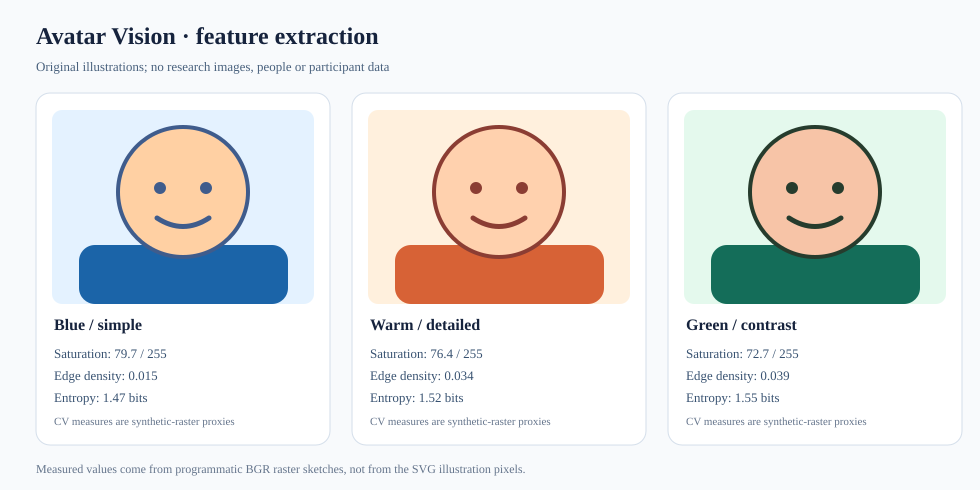
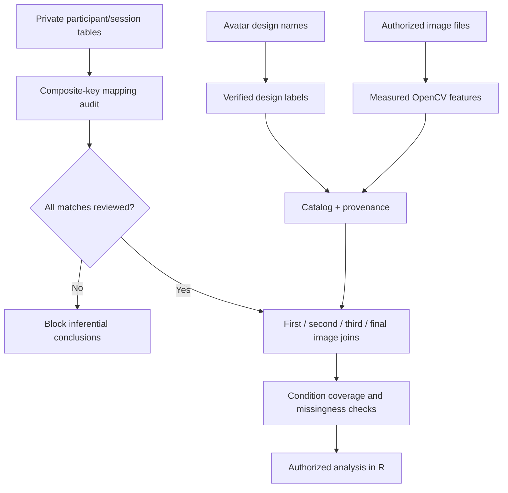

# Avatar Vision

### Computer Vision Feature Engineering for Human–Robot Interaction Research

**Python · OpenCV · NumPy · pandas · Jupyter · R / R Markdown · Research data engineering · Reproducible evaluation**

A research-engineering project studying the relationship between the visual design of robotic avatars and participants' selections in human–robot interaction experiments. The work builds a chain from avatar image attributes to participant sessions and analysis-ready features—with explicit safeguards against mismatched identities, incomplete coverage and fabricated visual labels.

**Research context:** Undergraduate research at Arizona State University, involving an ASU/OSU robotic-avatar study. The author has confirmed permission to publish the source code. Participant responses, raw session logs, avatar artwork, original model tables and other restricted research assets are **not** included.

> **Status:** Public engineering utilities and synthetic regression tests are reproducible. The historical study's inferential results are **not independently reproduced**; eight historical session matches are flagged for review and female-only visual feature exports do not establish full mixed-gender avatar coverage. The repository makes these limits visible rather than hiding them.

## Why this project matters

Experimental robot-avatar research combines images, generated design labels, robot-session logs and participant questionnaires. The hard engineering problem is not a single model call—it is preserving which image **was actually shown or selected**, in which session, under which condition, while preventing missing/incorrect features from contaminating statistical inference.

This repository makes that workflow inspectable and tests key contracts using synthetic records.

### Visual overview — original synthetic example



*The three illustrations are newly created for documentation. Their displayed numbers are computed from separately generated synthetic BGR rasters; neither the images nor the metrics represent study participants or reproduce the historical avatar artwork.*

**Key technical distinction:** generated avatar-design labels are parsed from documented filenames, while image statistics are measured from pixels. The [feature dictionary](docs/FEATURE_DICTIONARY.md) defines each metric, its units, exact operation and interpretation limits. No appearance classifier is being claimed.

## Project at a glance

| Private source reviewed | Measured scope / provenance |
|---|---|
| Original avatar image-metrics catalog | **384 names**: 192 female and 192 male design variants; 26 fields, some design metadata and some pixel metrics |
| Earlier female-only feature table | 168 rows × 54 columns; historical exploratory features |
| Later female-only feature table | 192 rows × 54 columns; **not** a complete mixed-gender feature table |
| Participant records | 190 composite participant/version keys, across `create_av` (62), `human_av` (64), `no_av` (64) |
| Source session mapping statuses | 182 matched, 7 marked for review, 1 unresolved |
| Catalog reference audit | All 124 actual first-avatar names, 61 second, 48 third and 124 final references resolve in the 384-name catalog; missing/sentinel selections stay missing |

Counts above were calculated from the restricted original research files for this review and are reported only in aggregate. **No participant-level data is in the repository.** The historical count 192 × 54 describes a female-only table; it is **not** 10,368 independently verified observed computer-vision features or evidence of completed inferential analysis.

## Architecture and research workflow



### Engineering contributions

**1. Reproducible image feature extraction.** `src/avatar_vision/features.py` parses filename-encoded *design* factors and measures image-level HSV color, pixel brightness, contrast, entropy, edges, sharpness proxies, texture and symmetry. It does **not** pretend gender-coded design metadata is an AI demographic prediction or infer facial anatomy from generator templates.

**2. Robust research-data validation.** `src/avatar_vision/audit.py` checks composite keys, unique image catalog names, reference coverage, missing participant keys and unresolved session matches. `quality.py` validates plausible measurement ranges and malformed numeric values.

**3. Condition-aware participant feature joining.** `src/avatar_vision/aggregate.py` aligns original first, second, third and final avatar references with the all-gender catalog. It retains no-avatar conditions and missing selections rather than replacing them with incorrect image proxies. Participant-level outputs stay private.

**4. A preserved research trail.** Five historical Jupyter notebooks and five R/R Markdown sources remain in `legacy/`. They are labeled exploratory because the original code contains female-only subsets, historical proxy attributes, and validation gaps. The tested utilities do not silently rewrite published-looking model results.

**5. Runnable, privacy-safe quality gates.** Synthetic tests exercise mapping and condition coverage, invalid keys, missing references, restricted columns, pixel measures, filename parsing, measurement bounds and the new lab-approval inference gate. The rendered demo and feature dictionary are kept synchronized with code. GitHub Actions is configured for Python 3.11–3.13 (remote runs are not yet verified).

## Install and run

**Requirements:** Python 3.10+ (Python 3.11–3.13 in configured CI). R and the original research datasets are only necessary for separate, authorized historical analyses.

```bash
python -m venv .venv
source .venv/bin/activate
pip install -e '.[test,vision]'
pytest -q
python scripts/demo_synthetic.py
python scripts/build_feature_dictionary.py --check
python scripts/create_visual_demo.py --check
python scripts/audit_notebooks.py
python scripts/scan_public_release.py
```

The synthetic demonstration exercises the real catalog-audit and participant-join functions with **invented** data; it does not expose or claim to reconstruct experimental subjects. The demo also reports real deterministic pixel measurements on a synthetic color image.

## Private-data reproduction (authorized researchers)

```bash
python scripts/audit_private_dataset.py \
  --mapping /path/to/private/OSU_avatar_mapping_input.csv \
  --catalog /path/to/private/OSU_avatar_image_metrics_input.csv \
  --participants /path/to/private/d_osu_final.csv
```

The audit deliberately returns nonzero until the ambiguous session assignments have been adjudicated. The separate private aggregation script validates keys and writes output only to a `private` or `restricted` directory. Original participant IDs and session details must never be committed.

Read the [feature dictionary](docs/FEATURE_DICTIONARY.md), [release checklist](docs/RELEASE_CHECKLIST.md), [research methods](docs/METHODS.md), [data-quality findings](docs/RESEARCH_INTEGRITY.md), [engineering decisions](docs/ENGINEERING_DECISIONS.md), [step-by-step reproduction guide](docs/REPRODUCIBILITY.md), and [verification evidence](docs/VERIFICATION.md) before making scientific claims.

## Repository layout

```text
src/avatar_vision/     Tested feature extraction, catalog QA, joins and audit
scripts/               Synthetic demo, private-data tools and privacy scanner
tests/                 Tests using exclusively invented data
legacy/notebooks/      Historical research notebooks, cleared of outputs
legacy/analysis/       Historical R and R Markdown analysis code
analysis/              New guarded exploratory R analysis example (not executed)
docs/assets/           Original synthetic SVG illustration (no original artwork)
docs/                  Methods, data governance, integrity and reproducibility
.github/workflows/     Public CI configuration (not yet executed remotely)
```

## Research integrity and limitations

- The publicly available code demonstrates feature extraction and mapping safeguards, **not a trained classifier** or a validated causal effect of avatar design.
- The historical 54-column exports include design attributes and derived proxy metrics; these must not be described as 54 directly observed visual detections.
- No images, survey responses, participant IDs, source CSVs or third-party model weights are redistributed.
- Source-level synthetic tests do not establish model accuracy, inter-rater agreement or the validity of legacy regression results.
- Before inferential results are released: resolve eight source session statuses, verify actual avatars across all conditions, review human-coded attribute provenance, and rerun approved study models with transparent inclusion/exclusion rules. The new guarded R example refuses modeling while unresolved mappings remain; it is not a reproduced study result.

**Responsible attribution:** Source is provided for inspection with the research team's permission; no blanket license to redistribute research datasets or collaborators' IP is implied.
