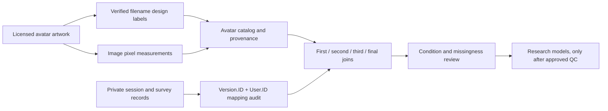

# Methods and definitions

## Goal

This project examines how experimental avatar design options can be represented as structured measurements and aligned with human–robot interaction session records. It is **not** a face-recognition, demographic-inference or robot-control system.

## Stages

| Metric | Definition | Interpretation limit |
|---|---|---|
| Mean saturation | Mean of the S channel in OpenCV HSV (0–255) | Image color measure, not user arousal |
| Mean brightness | Mean V channel in HSV (0–255) | Pixel brightness, not warmth or approval |
| Contrast | Standard deviation of grayscale luminance | Image statistic, not perceived realism |
| Shannon entropy | `-sum(p * log2(p))` over grayscale histogram | Distribution variability, not visual attractiveness |
| Edge density | Proportion of Canny-edge pixels | Highly sensitive to resolution and thresholds |
| Laplacian variance | Variance of grayscale Laplacian | Focus/texture proxy, not a valid craftsmanship label |
| Pixel symmetry | `1 - mean(abs(gray - horizontal_flip(gray)))/255` | Only a full-frame symmetry proxy; not facial symmetry |
| Local texture | Mean absolute deviation from a 3×3 Gaussian blur | Dependent on scale and preprocessing |

**Reproduction caution:** the new pixel-measurement functions are implemented for inspectability, but they do not claim numerical equivalence to historical image-processing configurations. To reproduce historical metrics exactly, the preprocessing, crop, dimensions, thresholds and libraries must be matched.

## Design metadata versus visual inference

The filename convention explicitly encodes avatar type, design gender, expression, clothing color, attire, logo and variant. These labels are returned as `design_*` fields to prevent their being described as computer-vision predictions. Neither image metrics nor naming rules establish participant demographics or psychology.

## Private participant alignment

Use the composite `(Version.ID, User.ID)` key. The `audit_mapping()` function rejects duplicate or null keys and checks whether every non-sentinel avatar name resolves in the all-gender catalog. It reports review-status counts and unmatched participant rows without disclosing identifying values. The join keeps all study conditions and creates separate `first_*`, `second_*`, `third_*`, `final_*` columns for each measured attribute. No-avatar conditions remain missing, never imputed from a template.

**Do not run inferential statistics on joined output merely because it passes schema checks.** The matching uncertainties, outcome definitions, condition-specific feature availability and model design must be resolved with the supervisor first.

## Guarded statistical analysis

`analysis/guarded_model_example.R` is a **new, explicitly exploratory example**, not the historical validated analysis. It refuses to estimate coefficients unless every mapping status is `Matched`, restricts image-selected features to the `create_av` condition, checks for duplicate keys and sufficient complete cases, and writes only to a private directory. Its simple OLS specification is for demonstrating leakage prevention and missingness discipline; it is **not** a replacement for the supervisor-approved research model. It is not executed in this review environment because R is unavailable.
